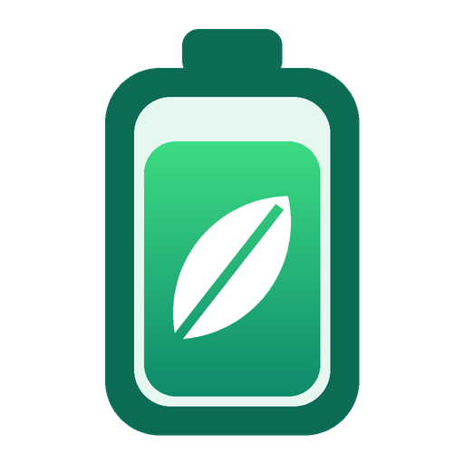

# Chill Mode

A one-panel battery optimizer for Windows 10/11 laptops. Every battery-related setting sits on one scrollable panel with toggles, drop-downs, radio buttons and sliders. **Optimize for battery** applies them all in one click.

* **Nothing to install.** It's a single PowerShell + WPF script that runs on the Windows PowerShell 5.1 built into Windows.
* **Plugged-in performance is left alone.** Power-plan settings are written only to the *On battery* side of the active plan.
* **Every change can be undone.** The original value of each setting is saved before its first change, and **Restore original** puts it back.

## Install

1. Download **`ChillMode-Setup-<version>.exe`** from the [Releases](https://github.com/corum86/chill-mode/releases) page.
2. Run it and accept the admin prompt. The installer is not code-signed, so Windows SmartScreen may warn you first: click **More info -> Run anyway**.
3. Choose your shortcuts. You get Start menu entries for **Chill Mode**, **Optimize for battery** (one click, no window), **Restore original** and **Uninstall**. A desktop shortcut is optional.

The app is installed to `C:\Program Files\Chill Mode` and appears in **Settings -> Apps** with its own uninstaller. When you uninstall, you're asked whether to restore your original settings first.

### Run without installing

Download or clone this repo, double-click **`ChillMode.cmd`** and accept the UAC prompt. Admin rights are needed for power-plan and browser-policy settings.

The panel reads the current state of your system. Changes you make are highlighted, with a *"Will change: X -> Y"* note, until you click **Apply**.

| Button | What it does |
|---|---|
| **Optimize for battery** (one click) | Applies the Max Battery preset immediately |
| **Balanced saver** | Applies moderate savings that keep the laptop responsive |
| **Restore original** | Puts back every value Chill Mode changed |
| **Apply / Discard** | Applies or drops your manual changes |

### Command line / shortcuts

```bat
ChillMode.cmd /max        :: apply "Optimize for battery" without opening the window
ChillMode.cmd /restore    :: undo everything
```

```powershell
.\ChillMode.ps1 -Preset MaxBattery   # or Balanced
.\ChillMode.ps1 -Restore
```

## What it controls

| Section | Settings |
|---|---|
| **Power & Processor** | Windows power mode on battery (Best power efficiency / Balanced / Best performance), turbo boost mode, max processor state, processor energy preference (EPP), passive/active cooling, battery/energy saver threshold and brightness |
| **Graphics: Leverage the iGPU** | Per-app GPU preference (installed browsers, Discord, Slack, Spotify, Zoom, Teams, VS Code and Office are detected automatically, and you can add any other `.exe`), Intel Graphics power plan, AMD/hybrid "Switchable dynamic graphics" |
| **Display & Panel** | Refresh-rate cap (lists the rates your panel supports), brightness on battery, adaptive brightness, dim timeout and dim level, video playback optimization, video quality bias, dark mode (saves power on OLED), transparency, animations, plus a shortcut to Windows display settings for Dynamic Refresh Rate / HDR / content-adaptive brightness |
| **Browser Efficiency** | Hardware acceleration per browser (Chrome, Edge, Brave, Firefox), stop running in the background, Edge efficiency mode, sleeping tabs and timeout, startup boost, Chrome/Brave Energy Saver and Memory Saver |
| **Sleep & Timeouts** | Screen off, sleep, hibernate, lid-close action (all on battery) |
| **Wireless & Devices** | Wi-Fi power saving, PCIe ASPM, USB selective suspend, disk idle, Bluetooth radio on/off |
| **Background & System** | Block Store apps from running in the background, pause search indexing on battery, disable background game recording |

Settings that your hardware doesn't have, such as the Intel Graphics plan on an AMD laptop, are greyed out as *Not available on this device*.

### About browser hardware acceleration

The usual advice to "turn off hardware acceleration" is only half right. On a laptop with two GPUs, the drain comes from the browser waking the **dedicated** GPU. Chill Mode's presets do two things:

1. Pin the browser to the integrated GPU (Graphics section).
2. Keep hardware acceleration **on**, so video decoding and page drawing stay on that efficient iGPU. Software rendering on the CPU usually uses more power.

If a browser still wakes the dGPU, choose **Force OFF** for that browser.

Browser settings are applied as policies, so the browser will show *"Managed by your organization"*. Choose **Browser decides** / **Browser default** (or use Restore) to remove them. Restart the browser for changes to take effect.

## Presets

| Setting | Optimize for battery | Balanced saver |
|---|---|---|
| Power mode (battery) | Best power efficiency | Balanced |
| Turbo boost / max CPU | Disabled / 99% | Efficient enabled / 100% |
| EPP | 80 | 60 |
| Refresh rate | 60 Hz (or the lowest available rate of 48 Hz or more) | unchanged |
| Brightness on battery | 50% | unchanged |
| Dim after / dim level | 1 min / 20% | 2 min / 30% |
| Screen off / sleep / hibernate | 2 min / 5 min / 1 hr | 5 min / 15 min / 3 hr |
| Apps -> GPU | Power saving (iGPU) | Power saving (iGPU) |
| Intel / AMD graphics plan | Max battery / Force power-saving | Balanced / Optimize power savings |
| Dark mode, animations off | yes | unchanged |
| Transparency off | yes | yes |
| Wi-Fi / PCIe ASPM | Max saving / Max saving | Medium / Moderate |
| Edge efficiency mode | When unplugged | When unplugged and battery low |
| Chrome/Brave Energy Saver | Whenever unplugged | When battery is low |
| Store apps in background | blocked | unchanged |
| Bluetooth | never touched by presets | never touched by presets |

## Notes

* **Refresh rate** is a global display setting. Windows doesn't keep separate values for battery and plugged-in, so this one stays changed when you plug in. Use Windows' *Dynamic refresh rate* if your panel supports it.
* Power-plan changes apply to the **active** plan. If you switch plans, run Chill Mode again.
* The backup is stored in `%LOCALAPPDATA%\ChillMode\backup.json`.
* The Bluetooth toggle needs Windows PowerShell 5.1, which `ChillMode.cmd` uses.

## Building

* **Installer:** run `makensis -DVERSION=1.1.2 installer/ChillMode.nsi` (NSIS 3; works on Windows or Linux). The output goes to `dist/`. Pushing a `v*` tag makes GitHub Actions build the installer and attach it to a release.
* **Icon:** run `python3 tools/make_icon.py` (needs Pillow). It regenerates `assets/ChillMode.ico` (16-256 px) and `assets/ChillMode.png`.
